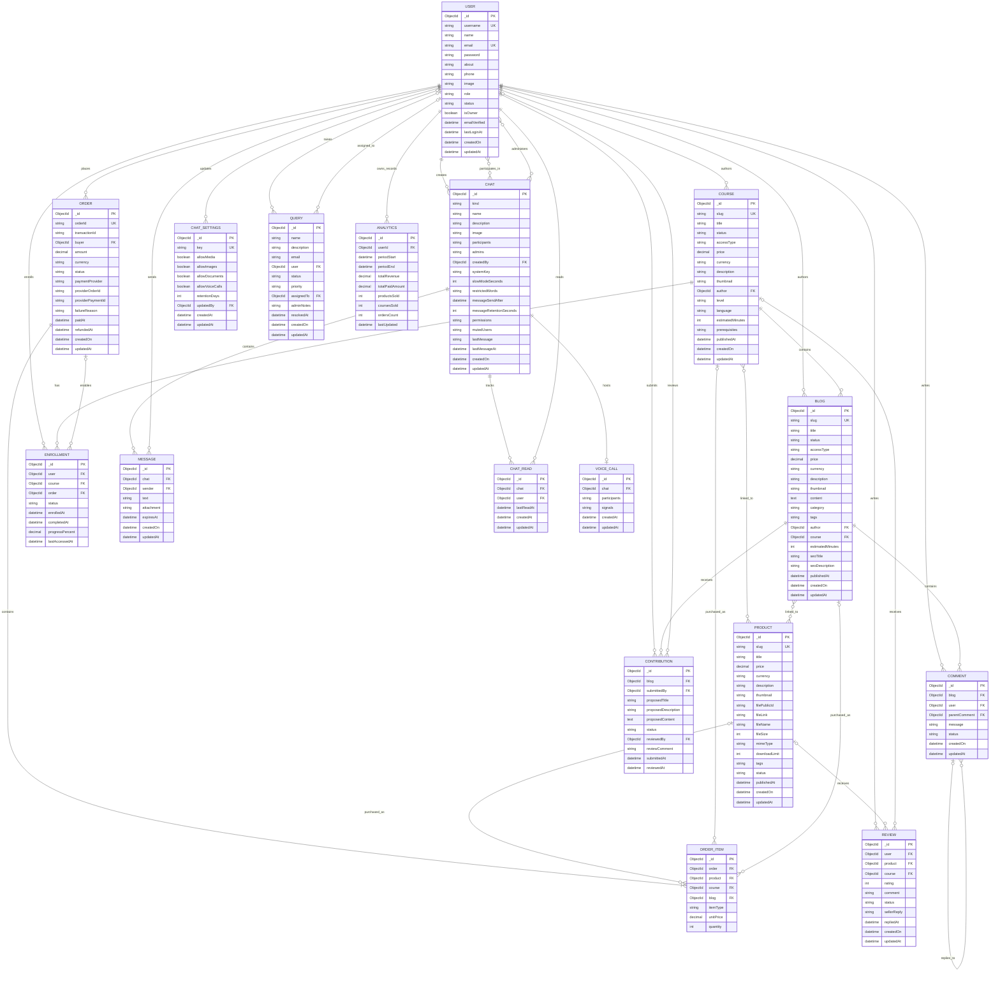

# Studic — Logical Entity Relationship Diagram

> **Status:** Proposed logical database design for the MCA project synopsis.  
> This diagram combines the current Studic data model with agreed future requirements. It is not a claim that every proposed entity is already implemented in MongoDB.

## Design decisions

- Roles: `student` and `admin`; Owner is an admin-level account with additional permissions. Seller is excluded from the target design.
- Blog body is Markdown stored in `BLOG.content`. YouTube embeds, images, code blocks, links and formatting remain inside this field; there is no separate Video entity.
- Students submit blog edits as contributions. Admins review and approve/reject them; students do not directly overwrite published content.
- Chat supports direct and group conversations. The current implementation stores participants/admins as arrays in Chat, not a separate ConversationMember collection.
- Product, Course and Blog purchases are represented through OrderItem in the proposed normalized design. The current repository Order model instead has direct optional references to Product/Course/Blog; migration is required before adopting OrderItem.
- Contribution and OrderItem are proposed entities. The other entities below are based on models found in the repository.
- Chat attachments remain embedded in Message. ChatSettings controls global media/document/voice-call settings.
- Analytics records are retained according to the one-year retention policy at the application/job level.

## ER diagram

## Implementation notes before schema migration

1. Add `isOwner` or an equivalent explicit permission mechanism to User; enforce owner-only admin creation/removal in authorization logic.
2. Add a Contribution model with immutable submission history and reviewer metadata.
3. Decide whether to migrate Order to OrderItem. If adopted, enforce that exactly one of product/course/blog is set per item.
4. Remove Seller role and seller references only after checking and migrating existing user/product/order data and all server functions that read them.
5. Keep Chat participants/admins as arrays unless a deliberate migration to a separate membership collection is planned.
6. Preserve the existing Comment, Analytics, ChatRead, VoiceCall, ChatSettings and Query models/relationships.
7. Reviews must reference exactly one of Product or Course, matching the existing model validation.
