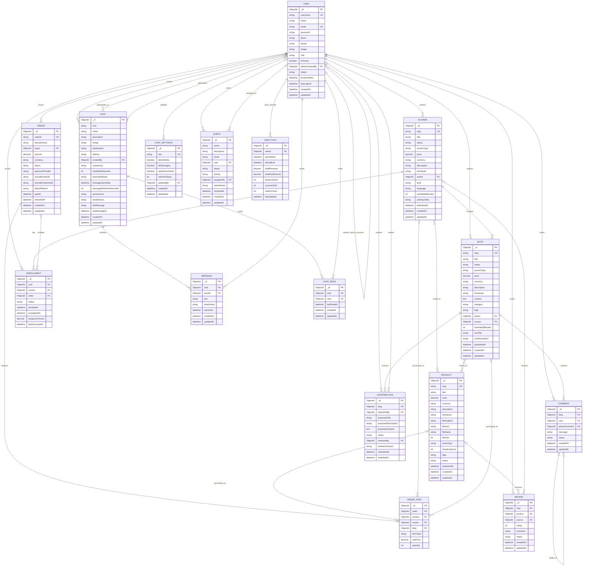

# Studic — Logical Entity Relationship Diagram

> **Status:** Final proposed logical database design for the MCA project synopsis.  
> This is the target design based on the agreed Studic requirements. Existing GitHub models may differ until the planned migrations and implementation work are completed.

## Final design decisions

- **Roles:** only `student` and `admin`. Owner is an admin account with the additional `isOwner` permission. Only Owner can add or remove Admin accounts.
- **Seller:** removed from the target design. Product has no seller reference; seller-specific user and order fields are excluded.
- **Blog content:** `BLOG.content` remains a Markdown text field. Text, headings, images, YouTube embeds, code blocks, links and formatting all live in this field. No separate Video entity is needed.
- **Blog contributions:** students submit proposed blog edits through `CONTRIBUTION`. Admin reviews and approves/rejects the submission. Students do not directly overwrite published blogs.
- **Orders:** the target design uses `ORDER_ITEM` so one order can contain one or more purchasable items. Each order item must reference exactly one of Product, Course or Blog.
- **Chat membership:** no separate `CONVERSATION_MEMBER` entity. Direct/group chat membership and chat admins are represented by participant/admin references associated with `CHAT`.
- **Attachments:** attachment metadata remains embedded in `MESSAGE`; no separate Attachment entity.
- **Voice calls:** excluded from this ERD. The previous VoiceCall model was only used for testing and is not part of the planned Studic system.
- **Reviews:** a review targets exactly one Product or Course.
- **Analytics:** one-year data retention is an application-level scheduled cleanup policy.

## ER diagram

## Current repository versus final proposed design

| Area | Current GitHub implementation | Final proposed design |
|---|---|---|
| User roles | `student`, `seller`, `admin` | `student`, `admin`; Owner permission via `isOwner` |
| Product seller reference | Product has `seller` | Remove seller reference |
| Order seller reference | Order has legacy `seller` field | Remove seller reference |
| Blog edit workflow | No dedicated contribution model found | Add `CONTRIBUTION` |
| Order items | Order directly references optional Product/Course/Blog | Add normalized `ORDER_ITEM` |
| Owner permission | No dedicated owner flag found | Add `isOwner`; owner-only admin management |
| Chat membership | Chat stores participants/admins arrays | Keep Chat-based membership; no separate ConversationMember |
| YouTube videos | No separate Video model | Keep embeds in Markdown `BLOG.content` |
| Voice calls | VoiceCall model exists for testing | Exclude from planned system |
| Comments | BlogData Comment model | Keep Comment |
| Analytics | Analytics model exists | Keep Analytics; retain one year |
| Chat settings | ChatSettings model exists | Keep media/document controls; no voice-call setting |

## Migration and implementation notes

1. Update User role validation to allow only `student` and `admin`; add `isOwner` and enforce owner-only admin creation/removal on the server.
2. Migrate or remove existing seller accounts and Product/Order seller references safely before deleting those fields from schemas and application code.
3. Add a Contribution model with immutable submission history, proposed Markdown content, status, reviewer and review timestamps.
4. Add OrderItem and migrate existing Order product/course/blog references. Enforce that exactly one target reference is set for each item.
5. Keep Chat participants/admins in the Chat model; do not add a ConversationMember collection.
6. Keep YouTube embeds and all other rich content in Markdown `BLOG.content`; do not create a Video collection.
7. Exclude VoiceCall and voice-call settings from the target product; remove the test-only model and related routes/UI when cleaning up implementation.
8. Keep Comment, Analytics, ChatRead, ChatSettings and Query as application entities.
9. Enforce that each Review references exactly one of Product or Course.
10. Enforce one-year analytics retention through a scheduled cleanup process.
